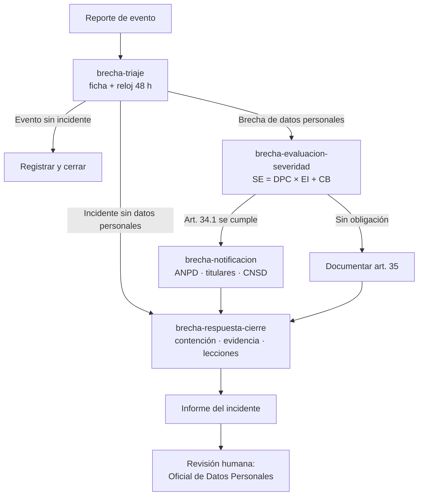

# TIF — Agente de IA para la gestión de incidentes y brechas de datos personales

Trabajo de Investigación Formativa (UNSA, Área de Sistemas): skills y un agente de IA que apoyan el **PIMS** (Sistema de Gestión de Privacidad de la Información) en la **gestión de incidentes y brechas de datos personales**.

**Sustento normativo:**
- **ISO/IEC 27035-1/-2:2023**: proceso de gestión de incidentes.
- **ISO/IEC 27001 / 27002:2022**: controles 5.24 a 5.29 y 6.8.
- **ISO/IEC 27701**: extensión de privacidad, notificación de brechas de PII.
- **NIST SP 800-61 Rev. 3**: respuesta a incidentes.
- **ISO/IEC 27037**: evidencia digital.
- **ENISA**: severidad de brechas.
- **Ley N.° 29733** y su Reglamento, **D.S. N.° 016-2024-JUS**, arts. 34 a 36: notificación en 48 horas.

> Todos los casos son **ficticios**. Los resultados son **borradores de apoyo** que deben validar el Oficial de Datos Personales y el responsable de seguridad.

## Qué contiene

| Componente | Qué hace | Fase ISO/IEC 27035 | Ubicación |
|---|---|---|---|
| Skill `brecha-triaje` | ¿Evento, incidente o brecha? Clasifica, prioriza e inicia el reloj de 48 h | Detectar y reportar / Evaluar y decidir | `.claude/skills/brecha-triaje/` |
| Skill `brecha-evaluacion-severidad` | Severidad para los titulares (ENISA) y decisión de notificar (art. 34) | Evaluar y decidir | `.claude/skills/brecha-evaluacion-severidad/` |
| Skill `brecha-notificacion` | Borradores para la ANPD, los titulares y el CNSD | Responder | `.claude/skills/brecha-notificacion/` |
| Skill `brecha-respuesta-cierre` | Contención, evidencia, recuperación, causa raíz y lecciones aprendidas | Responder / Aprender lecciones | `.claude/skills/brecha-respuesta-cierre/` |
| Agente `agente-incidentes-brechas` | Coordina el ciclo completo y controla el plazo | Todo el ciclo | `.claude/agents/agente-incidentes-brechas.md` |
| Comando `/gestionar-incidente` | Lanza el agente con un solo paso | — | `.claude/commands/gestionar-incidente.md` |
| Base de conocimiento | Normativa peruana, estándares, severidad, taxonomía | — | `knowledge/` |
| Interfaz web | Aplicación React local con Docker, conexión con su suscripción o API key y cuenta regresiva de 48 h | — | `web/` |
| Casos de ejemplo | 9 escenarios simulados de la UNSA: ransomware en el Registro Académico, correo masivo a ingresantes, laptop de Bienestar, phishing bloqueado, aviso del proveedor del Campus Virtual, inyección SQL en admisión, cambio de notas, planilla en enlace público y DDoS | — | `examples/unsa/` |
| Proyecto de demo | UNSA (escenario simulado): inventario, contactos, políticas y logs para que el agente verifique los hechos | — | `demo/unsa-base/`, `demo/unsa-ransomware/`, `demo/unsa-admision/`, `demo/unsa-notas/` |
| Contextos subidos | Organizaciones cargadas desde la interfaz (inventario, logs, políticas); no se versionan | — | `contextos/` |
| Permisos | El agente solo escribe en `salidas/` | — | `.claude/settings.json` |

## Flujo del agente



## Cómo usarlo

**Interfaz web** (la forma más simple): `docker compose up --build` (o `npm start`) y abrir http://localhost:3100. Ver [web/README.md](web/README.md) y la [guía de pruebas](examples/guia-de-pruebas.md).

**Terminal:**

Requiere [Claude Code](https://claude.com/claude-code). Abre una sesión en esta carpeta y usa:

```
/gestionar-incidente examples/unsa/unsa-01-ransomware-registro-academico.md contexto: demo/unsa-ransomware
/gestionar-incidente examples/unsa/unsa-04-phishing-docentes-bloqueado.md
```

**Demo con proyecto** (el agente verifica el reporte contra inventario, logs y políticas de una clínica ficticia):

```
/gestionar-incidente examples/unsa/unsa-01-ransomware-registro-academico.md contexto: demo/unsa-ransomware
```

Ver [demo/unsa-base/README.md](demo/unsa-base/README.md).

También puedes invocar un skill por separado, por ejemplo: *"¿Esto es una brecha? Se nos perdió una USB con planillas"* o *"Redacta la notificación a la ANPD del incidente INC-20261011-ransomware-sra"*.
Los resultados quedan en `salidas/<ID-del-incidente>/`.

## Estructura del repositorio

```
.
├── .claude/
│   ├── skills/          # 4 skills (SKILL.md + plantillas)
│   ├── agents/          # agente de incidentes y brechas
│   └── commands/        # comando /gestionar-incidente
├── knowledge/           # normativa peruana, estándares ISO/NIST, severidad, taxonomía
├── web/                 # interfaz web local (npm start)
├── archivos-demo/       # reportes y contexto de ejemplo para probar la interfaz
├── contextos/           # contextos subidos desde la interfaz (no se versionan)
├── examples/unsa/       # 9 escenarios simulados de la UNSA (examples/entradas/: casos de pruebas anteriores)
├── demo/                # proyecto ficticio (clínica) con logs, inventario y app
├── salidas/             # expedientes generados (no se versionan)
├── docs/                # documentación por etapa del TIF
│   └── informe/         # informe final
├── pruebas/             # plan y evidencias de pruebas
└── presentacion/        # diapositivas y guion de demo
```

## Documentación por etapa del TIF

| Etapa | Documento |
|---|---|
| De prompt a skill | [docs/01-de-prompt-a-skill.md](docs/01-de-prompt-a-skill.md) |
| Creación de skill | [docs/02-creacion-de-skills.md](docs/02-creacion-de-skills.md) |
| Construcción de asistente | [docs/03-asistente.md](docs/03-asistente.md) |
| Diseño de agente | [docs/04-diseno-agente.md](docs/04-diseno-agente.md) |
| Orquestación y automatización | [docs/05-orquestacion.md](docs/05-orquestacion.md) |
| Proyecto agéntico | [docs/06-proyecto-agentico.md](docs/06-proyecto-agentico.md) |
| Reparto del equipo | [docs/reparto-equipo.md](docs/reparto-equipo.md) |

## Equipo

| Integrante | Rol |
|---|---|
| Huacani Jara, Denise Andrea | Ver `docs/reparto-equipo.md` |
| Luque Condori, Luis Guillermo | Ver `docs/reparto-equipo.md` |
| Mollo Chuquicaña, Dolly Yadhira | Ver `docs/reparto-equipo.md` |
| Pacheco Palo, Fabiana Francinet | Ver `docs/reparto-equipo.md` |
| Valdivia Segovia, Ryan Fabian | Skills, agente, orquestación e integración |

Asignatura: Auditoría de Sistemas · Docente: Edward Vicente Zarate Carlos · Informe: [docs/informe/](docs/informe/)
