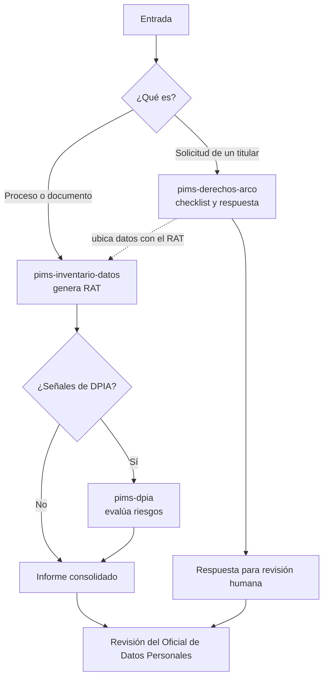

# TIF — Skills y agente de IA para un PIMS

Trabajo de Investigación Formativa (UNSA, Área de Sistemas): skills y un agente de IA que apoyan el **PIMS** (Sistema de Gestión de Privacidad de la Información, ISO/IEC 27701) bajo la **Ley N.° 29733** de Protección de Datos Personales del Perú.

> Todos los casos de ejemplo son **ficticios**. Los resultados son **borradores de apoyo** que debe validar un Oficial de Datos Personales.

## Qué contiene

| Componente | Qué hace | Ubicación |
|---|---|---|
| Skill `pims-inventario-datos` | Identifica datos personales y genera el RAT | `.claude/skills/pims-inventario-datos/` |
| Skill `pims-dpia` | Evalúa riesgos de privacidad (DPIA) y propone controles | `.claude/skills/pims-dpia/` |
| Skill `pims-derechos-arco` | Atiende solicitudes de derechos del titular | `.claude/skills/pims-derechos-arco/` |
| Agente `pims-orquestador` | Decide qué skills usar, coordina el flujo e informa | `.claude/agents/pims-orquestador.md` |
| Comando `/pims-analizar` | Lanza el flujo completo con un solo comando | `.claude/commands/pims-analizar.md` |
| Base de conocimiento | Ley, mapa ISO 27701, escala de riesgos | `knowledge/` |
| Casos de ejemplo | Entradas ficticias para probar | `examples/entradas/` |

## Flujo del proyecto agéntico



## Cómo usarlo

Requiere [Claude Code](https://claude.com/claude-code). Abre una sesión en esta carpeta y usa:

```
/pims-analizar examples/entradas/proceso-matricula-academia.md
/pims-analizar examples/entradas/solicitud-arco-ejemplo.md
```

O invoca cada skill por separado, por ejemplo: *"Arma el RAT de examples/entradas/proceso-matricula-academia.md"*.
Los resultados quedan en `salidas/`.

## Estructura del repositorio

```
.
├── .claude/
│   ├── skills/          # 3 skills (SKILL.md + plantilla)
│   ├── agents/          # agente orquestador
│   └── commands/        # comando /pims-analizar
├── knowledge/           # base de conocimiento (Ley 29733, ISO 27701, riesgos)
├── examples/entradas/   # casos ficticios de prueba
├── salidas/             # resultados generados (no se versionan)
├── docs/                # documentación por etapa del TIF
│   └── informe/         # informe final
├── pruebas/             # plan y evidencias de pruebas
└── presentacion/        # diapositivas y guion de demo
```

## Documentación por etapa del TIF

| Etapa | Documento |
|---|---|
| De prompt a skill | [docs/01-de-prompt-a-skill.md](docs/01-de-prompt-a-skill.md) |
| Creación de skill | [docs/02-creacion-de-skills.md](docs/02-creacion-de-skills.md) |
| Construcción de asistente | [docs/03-asistente.md](docs/03-asistente.md) |
| Diseño de agente | [docs/04-diseno-agente.md](docs/04-diseno-agente.md) |
| Orquestación y automatización | [docs/05-orquestacion.md](docs/05-orquestacion.md) |
| Proyecto agéntico | [docs/06-proyecto-agentico.md](docs/06-proyecto-agentico.md) |
| Reparto del equipo | [docs/reparto-equipo.md](docs/reparto-equipo.md) |

## Equipo

| Integrante | Rol |
|---|---|
| Ryan Valdivia | Skills, agente, orquestación e integración |
| _Compañero 2_ | Investigación, base de conocimiento, marco teórico y conclusiones |
| _Compañero 3_ | Pruebas, diapositivas, guion de demo y formato del informe |
